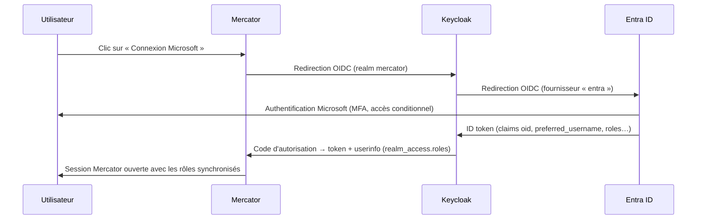

# Authentification OpenID Connect avec Microsoft Entra ID

## Vue d'ensemble

Ce guide décrit comment permettre aux utilisateurs de se connecter à Mercator avec leur compte
**Microsoft Entra ID** (anciennement Azure AD), en s'appuyant sur le protocole **OpenID Connect**.

Mercator ne dialogue pas directement avec Entra ID : il utilise **Keycloak** comme courtier d'identité
(*identity broker*). Keycloak délègue l'authentification à Entra ID, convertit les rôles d'application
Entra en rôles Keycloak, puis transmet l'identité à Mercator.



Avantages de cette architecture :

- aucune modification de Mercator, seule la configuration change ;
- les politiques Microsoft (MFA, accès conditionnel, comptes désactivés) s'appliquent à la connexion ;
- le même realm Keycloak peut servir d'autres applications (GLPI, etc.).

Le fonctionnement général du SSO dans Mercator (auto-provisioning, fallback local, synchronisation des
rôles) est décrit dans [KEYCLOAK.fr.md](KEYCLOAK.fr.md).

## Prérequis

- Un tenant Microsoft Entra ID et un compte disposant au minimum du rôle **Administrateur d'applications**.
- Un serveur Keycloak accessible en HTTPS par les utilisateurs et capable de joindre
  `login.microsoftonline.com`.
- Un accès administrateur à Mercator (fichier `.env`).

Dans ce guide, les valeurs suivantes sont utilisées à titre d'exemple ; adaptez-les à votre environnement :

| Élément                     | Valeur d'exemple                     |
|-----------------------------|--------------------------------------|
| URL de Keycloak             | `https://keycloak.example.com`       |
| URL de Mercator             | `https://mercator.example.com`       |
| Realm Keycloak              | `mercator`                           |
| Alias du fournisseur Entra  | `entra`                              |
| Client Keycloak de Mercator | `mercator`                           |

Les rôles utilisés sont les rôles par défaut de Mercator : `Admin`, `User`, `Auditor` et `Cartographer`.
Si vous avez créé d'autres rôles, ajoutez-les de la même manière à chaque étape.

## Étape 1 — Configurer Microsoft Entra ID

### 1.1 Inscrire l'application

Dans le centre d'administration Entra : **Identité → Applications → Inscriptions d'applications →
Nouvelle inscription**.

| Champ                     | Valeur                                                                   |
|---------------------------|--------------------------------------------------------------------------|
| Nom                       | `Keycloak – Mercator`                                                    |
| Types de comptes          | **Comptes dans cet annuaire organisationnel uniquement** (mono-locataire) |
| URI de redirection (Web)  | `https://keycloak.example.com/realms/mercator/broker/entra/endpoint`      |

Après la création, notez sur la page **Vue d'ensemble** :

- l'**ID d'application (client)** ;
- l'**ID de l'annuaire (locataire)**.

> L'URI de redirection doit correspondre exactement au realm et à l'alias du fournisseur configurés
> dans Keycloak à l'étape 2. Keycloak l'affiche dans le champ *Redirect URI* du fournisseur d'identité.

### 1.2 Créer un secret client

**Certificats et secrets → Secrets client → Nouveau secret client.**

Copiez immédiatement la **valeur** du secret (elle n'est plus affichée ensuite) et notez sa date
d'expiration.

> ⚠️ À l'expiration du secret, plus aucun utilisateur ne pourra se connecter par SSO. Planifiez son
> renouvellement.

### 1.3 Ajouter les claims optionnelles

**Configuration des jetons → Ajouter une revendication facultative → Type de jeton : ID**, puis cochez :

- `email`
- `given_name`
- `family_name`

Acceptez l'ajout de l'autorisation Microsoft Graph `email` / `profile` si cela vous est proposé.

### 1.4 Définir les rôles d'application

**Rôles d'application → Créer un rôle d'application**, une fois par rôle Mercator :

| Nom d'affichage | Types de membres autorisés | Valeur         |
|-----------------|----------------------------|----------------|
| Admin           | Utilisateurs/Groupes       | `Admin`        |
| User            | Utilisateurs/Groupes       | `User`         |
| Auditor         | Utilisateurs/Groupes       | `Auditor`      |
| Cartographer    | Utilisateurs/Groupes       | `Cartographer` |

La **valeur** est transmise dans la claim `roles` de l'ID token.

### 1.5 Restreindre l'accès et affecter les rôles

**Identité → Applications → Applications d'entreprise → Keycloak – Mercator** :

1. **Propriétés** : passez **Affectation requise ?** à **Oui**. Seuls les utilisateurs et groupes
   affectés pourront se connecter.
2. **Utilisateurs et groupes → Ajouter un utilisateur/groupe** : affectez vos groupes Entra aux rôles
   d'application (par exemple le groupe `GRP-Mercator-Admins` au rôle `Admin`).

> L'affectation de groupes à une application d'entreprise nécessite une licence Entra ID P1 ou
> supérieure. Sans cette licence, affectez les utilisateurs individuellement.

## Étape 2 — Configurer Keycloak

Toutes les opérations se font dans le realm `mercator`.

### 2.1 Créer les rôles du realm

**Realm roles → Create role** : créez `Admin`, `User`, `Auditor` et `Cartographer`.

> Les noms doivent être **strictement identiques** aux titres des rôles dans Mercator
> (**Administration → Rôles**), majuscules comprises.

### 2.2 Ajouter Entra ID comme fournisseur d'identité

**Identity providers → OpenID Connect v1.0.**

| Champ                     | Valeur                                                                                   |
|---------------------------|------------------------------------------------------------------------------------------|
| Alias                     | `entra`                                                                                  |
| Display name              | `Microsoft`                                                                              |
| Use discovery endpoint    | ON                                                                                       |
| Discovery endpoint        | `https://login.microsoftonline.com/<ID-locataire>/v2.0/.well-known/openid-configuration` |
| Client authentication     | Client secret sent as post                                                               |
| Client ID                 | ID d'application (client) noté à l'étape 1.1                                             |
| Client Secret             | Valeur du secret notée à l'étape 1.2                                                     |

Enregistrez, puis complétez dans l'onglet **Settings** :

| Champ                  | Valeur                   | Pourquoi                                                    |
|------------------------|--------------------------|-------------------------------------------------------------|
| Validate Signatures    | ON (Use JWKS URL)        | Vérifie la signature des jetons émis par Microsoft          |
| Use PKCE               | ON, méthode `S256`       | Protège l'échange du code d'autorisation                    |
| Scopes                 | `openid profile email`   | Claims nécessaires à l'identification                       |
| Trust Email            | OFF                      | L'email Entra n'est pas une preuve d'identité               |
| Sync mode              | **Force**                | Attributs et rôles recalculés à chaque connexion            |

Utilisez toujours l'**ID du locataire** dans l'URL de discovery, jamais `common` ou `organizations` :
cela garantit que seuls les comptes de votre tenant sont acceptés.

### 2.3 Configurer les mappers du fournisseur

**Identity providers → entra → Mappers → Add mapper.**

**Nom d'utilisateur**

| Champ         | Valeur                                                  |
|---------------|---------------------------------------------------------|
| Name          | `username`                                              |
| Sync mode     | Force                                                   |
| Mapper type   | Username Template Importer                              |
| Template      | `${CLAIM.preferred_username \| localpart \| lowercase}` |
| Target        | LOCAL                                                   |

Ce mapper transforme `jean.dupont@example.com` en `jean.dupont`, ce qui permet de retrouver un compte
Mercator existant dont le login est `jean.dupont`. Si vos logins Mercator sont des adresses complètes,
utilisez simplement `${CLAIM.preferred_username | lowercase}`.

**Attributs**

| Name        | Mapper type        | Claim         | User attribute name |
|-------------|--------------------|---------------|---------------------|
| `email`     | Attribute Importer | `email`       | `email`             |
| `firstName` | Attribute Importer | `given_name`  | `firstName`         |
| `lastName`  | Attribute Importer | `family_name` | `lastName`          |

**Rôles** — un mapper par rôle :

| Name                | Sync mode | Mapper type   | Claim   | Claim value    | Role           |
|---------------------|-----------|---------------|---------|----------------|----------------|
| `role-admin`        | Force     | Claim to Role | `roles` | `Admin`        | `Admin`        |
| `role-user`         | Force     | Claim to Role | `roles` | `User`         | `User`         |
| `role-auditor`      | Force     | Claim to Role | `roles` | `Auditor`      | `Auditor`      |
| `role-cartographer` | Force     | Claim to Role | `roles` | `Cartographer` | `Cartographer` |

### 2.4 Créer le client Mercator

**Clients → Create client.**

| Champ                     | Valeur                                                   |
|---------------------------|----------------------------------------------------------|
| Client type               | OpenID Connect                                           |
| Client ID                 | `mercator`                                               |
| Client authentication     | ON (client confidentiel)                                 |
| Authentication flow       | Standard flow uniquement                                 |
| Valid redirect URIs       | `https://mercator.example.com/login/keycloak/callback`   |
| Web origins               | `https://mercator.example.com`                           |

Récupérez ensuite le secret dans l'onglet **Credentials**.

### 2.5 Exposer les rôles dans le userinfo

Mercator lit les rôles via l'endpoint `userinfo` de Keycloak. Par défaut, Keycloak ne les y place pas.

**Client scopes → roles → Mappers → realm roles** : activez **Add to userinfo**.

> Sans ce réglage, la connexion fonctionne mais aucun rôle n'est transmis à Mercator.

### 2.6 (Optionnel) Rediriger directement vers Microsoft

Pour éviter l'écran de connexion Keycloak :

**Authentication → browser → Identity Provider Redirector → ⚙ (Settings)** :

- Alias : `entra-redirect`
- Default Identity Provider : `entra`

Les utilisateurs arrivent alors directement sur la page de connexion Microsoft.

## Étape 3 — Configurer Mercator

Dans le fichier `.env` de Mercator :

```env
KEYCLOAK_ENABLED=true
KEYCLOAK_CLIENT_ID=mercator
KEYCLOAK_CLIENT_SECRET="<secret du client Keycloak (étape 2.4)>"
KEYCLOAK_REDIRECT_URI=https://mercator.example.com/login/keycloak/callback
KEYCLOAK_BASE_URL=https://keycloak.example.com
KEYCLOAK_REALM=mercator
KEYCLOAK_BTN_LABEL="Connexion Microsoft"
KEYCLOAK_FALLBACK_LOCAL=true
KEYCLOAK_AUTO_PROVISION=true
KEYCLOAK_AUTO_PROVISION_ROLE=User
KEYCLOAK_SYNC_ROLES=true
```

| Variable                       | Description                                                                         |
|--------------------------------|-------------------------------------------------------------------------------------|
| `KEYCLOAK_ENABLED`             | Active le bouton SSO sur la page de connexion                                       |
| `KEYCLOAK_CLIENT_ID`           | Identifiant du client Keycloak (étape 2.4)                                          |
| `KEYCLOAK_CLIENT_SECRET`       | Secret du client Keycloak — **pas** le secret Entra                                 |
| `KEYCLOAK_REDIRECT_URI`        | URL de retour, identique à celle déclarée dans Keycloak                             |
| `KEYCLOAK_BASE_URL`            | URL racine de Keycloak, **sans** `/realms/...`                                      |
| `KEYCLOAK_REALM`               | Nom du realm                                                                        |
| `KEYCLOAK_BTN_LABEL`           | Libellé du bouton sur la page de connexion                                          |
| `KEYCLOAK_FALLBACK_LOCAL`      | Redirige vers la connexion locale en cas d'échec SSO                                |
| `KEYCLOAK_AUTO_PROVISION`      | Crée le compte Mercator à la première connexion                                     |
| `KEYCLOAK_AUTO_PROVISION_ROLE` | Rôle attribué aux comptes créés automatiquement                                     |
| `KEYCLOAK_SYNC_ROLES`          | Attribue les rôles Mercator correspondant aux rôles reçus de Keycloak               |

Rechargez ensuite la configuration :

```bash
php artisan config:clear
```

Avec Docker, redémarrez le conteneur après modification des variables d'environnement.

## Étape 4 — Vérifier la configuration

1. Ouvrez Mercator : la page de connexion affiche le bouton **Connexion Microsoft**.
2. Connectez-vous avec un compte Entra affecté au rôle `Cartographer`.
3. Dans Keycloak, **Users → (utilisateur) → Identity provider links** : le lien `entra` est présent.
   L'onglet **Role mapping** affiche le rôle `Cartographer`.
4. Dans Mercator, **Administration → Utilisateurs** : le compte existe et possède le rôle `Cartographer`.
5. Dans **Administration → Journal d'audit**, l'entrée `SSO Login (Keycloak)` contient les rôles reçus
   dans `keycloak_roles`.
6. Tentez une connexion avec un compte Entra **non affecté** à l'application : Microsoft doit refuser
   l'accès (erreur `AADSTS50105`).

## Correspondance des comptes et des rôles

### Comptes

À la connexion, Mercator recherche un utilisateur local :

1. dont le `login` correspond au nom d'utilisateur Keycloak (`preferred_username`) ;
2. à défaut, dont l'`email` correspond.

Si aucun compte n'est trouvé et que `KEYCLOAK_AUTO_PROVISION=true`, le compte est créé avec le rôle
`KEYCLOAK_AUTO_PROVISION_ROLE` et un mot de passe aléatoire inutilisable.

Pour rattacher des comptes Mercator existants, assurez-vous que leur login correspond au résultat du
mapper *username* (étape 2.3).

### Rôles

Les rôles reçus sont **ajoutés** aux rôles existants du compte Mercator : un rôle retiré dans Entra
n'est pas retiré dans Mercator. Pour révoquer un accès, retirez le rôle dans Mercator, ou désactivez
l'affectation de l'utilisateur dans Entra pour bloquer toute connexion SSO.

Un rôle reçu qui n'existe pas dans Mercator est ignoré.

## Recommandations de sécurité

- **Mono-locataire** : utilisez l'ID du locataire dans l'URL de discovery, jamais `common`.
- **Affectation requise** : activez-la dans l'application d'entreprise (étape 1.5) pour que l'accès à
  Mercator soit une décision explicite.
- **Accès conditionnel** : appliquez vos stratégies (MFA, appareils conformes, emplacements) à
  l'application d'entreprise *Keycloak – Mercator*.
- **Compte de secours** : conservez au moins un compte administrateur local Mercator, non lié au SSO,
  au mot de passe robuste et stocké de manière sécurisée, pour intervenir en cas d'indisponibilité
  d'Entra ou de Keycloak.
- **Fallback en production** : une fois le SSO validé, envisagez `KEYCLOAK_FALLBACK_LOCAL=false`.
- **Secrets** : planifiez le renouvellement du secret Entra avant son expiration et ne versionnez
  jamais le fichier `.env`.
- **Déconnexion** : la déconnexion de Mercator ferme la session Mercator, mais pas les sessions Keycloak
  et Microsoft. Sur un poste partagé, l'utilisateur doit également se déconnecter de son compte
  Microsoft.

## Dépannage

| Symptôme                                                           | Cause probable                                                                             | Solution                                                                                         |
|--------------------------------------------------------------------|--------------------------------------------------------------------------------------------|--------------------------------------------------------------------------------------------------|
| Microsoft affiche `AADSTS50011` (redirect URI mismatch)            | L'URI de redirection Entra ne correspond pas à celle de Keycloak                           | Copiez l'URI affichée dans Keycloak (*Redirect URI* du fournisseur) dans l'inscription Entra      |
| Microsoft affiche `AADSTS7000215` (invalid client secret)          | Secret Entra erroné ou expiré                                                              | Générez un nouveau secret et mettez-le à jour dans Keycloak                                      |
| Microsoft affiche `AADSTS50105`                                    | Utilisateur non affecté à l'application                                                    | Affectez l'utilisateur ou son groupe dans l'application d'entreprise                             |
| Keycloak affiche `Invalid parameter: redirect_uri`                 | `KEYCLOAK_REDIRECT_URI` absent des *Valid redirect URIs* du client `mercator`             | Alignez les deux valeurs (protocole, hôte, chemin)                                               |
| Mercator affiche « Authentication failed »                         | Secret client Keycloak erroné, `KEYCLOAK_BASE_URL` contenant `/realms/...`, horloge décalée | Vérifiez le `.env`, consultez `storage/logs/laravel.log` (message `Keycloak authentication failed`) |
| Mercator affiche « User "…" is not a valid Mercator user »         | Compte inexistant et auto-provisioning désactivé                                           | Créez le compte dans Mercator ou activez `KEYCLOAK_AUTO_PROVISION`                               |
| Connexion réussie mais aucun rôle attribué                         | Rôles absents du userinfo, ou noms de rôles différents                                     | Activez *Add to userinfo* (étape 2.5) et vérifiez la casse des rôles                             |
| Rôles absents dans Keycloak après connexion                        | Claim `roles` absente de l'ID token ou mapper mal configuré                                | Vérifiez l'affectation dans Entra et les mappers *Claim to Role*                                 |
| Un second compte Mercator est créé pour un utilisateur existant    | Le login généré par Keycloak ne correspond pas au login Mercator                           | Ajustez le template du mapper *username* ou le login du compte Mercator                         |
| Le bouton SSO n'apparaît pas                                       | `KEYCLOAK_ENABLED` non pris en compte                                                      | Exécutez `php artisan config:clear` ou redémarrez le conteneur                                   |

Pour inspecter les claims reçues par Keycloak, activez temporairement le niveau de log `DEBUG` pour la
catégorie `org.keycloak.broker` dans Keycloak.

## Références

- [Guide Keycloak de Mercator](KEYCLOAK.fr.md)
- [Keycloak — Identity Brokering](https://www.keycloak.org/docs/latest/server_admin/#_identity_broker)
- [Microsoft — Ajouter des rôles d'application et les recevoir dans le jeton](https://learn.microsoft.com/fr-fr/entra/identity-platform/howto-add-app-roles-in-apps)
- [Microsoft — Revendications facultatives](https://learn.microsoft.com/fr-fr/entra/identity-platform/optional-claims)
